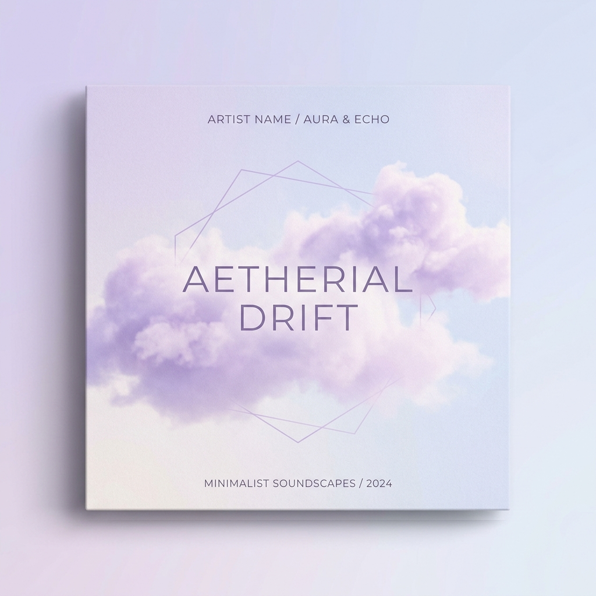

# 🎵 Aura Melody — Modern Pastel Music Player

A complete, modern, and fully functional music player web application designed with an exclusive **light color palette** featuring soft lavender, pastel blue, and electric violet accents.



---

## 🎨 UI & UX Design

- **Light Aesthetic**: Bright, elegant UI built with soft lavender (`#F8F9FE`), pastel blue (`#E0F2FE`), and frosted glassmorphism surfaces (`rgba(255, 255, 255, 0.88)`). No dark mode or black backgrounds.
- **Spinning Vinyl Animation**: An animated vinyl disc emerges from the album sleeve and rotates continuously during music playback.
- **Full-Width Sound-Wave Visualizer**: Real-time frequency visualizer beneath the artwork reacting dynamically across all 32 frequency bands.
- **Fluid Micro-Animations**: Smooth button scale transitions, pulsing play button, and animated equalizer bars.
- **Responsive Layout**: Designed for seamless listening across desktop, tablet, and mobile devices.

---

## 🎧 Core Features

- **Playback Controls**: Play, Pause, Next track, Previous track.
- **Audio Engine**: Powered by the HTML5 Audio API and client-side harmonic Web Audio synthesizer (`OfflineAudioContext`) for instant, zero-latency playback with zero external network dependencies.
- **Scrubbing & Seek**: Interactive progress bar with click/drag seeking and timestamp hover tooltips (`M:SS`).
- **Volume & Mute**: Working volume slider with percentage readout and 1-click mute/unmute toggle.
- **Playback Speed**: Adjustable speed chips (`0.75x`, `1.0x`, `1.25x`, `1.5x`, `2.0x`).
- **Modes**:
  - **Autoplay Switch**: Seamlessly auto-advances to the next song when a track finishes.
  - **Repeat Modes**: 3-state toggle (`Repeat All`, `Repeat One`, `Repeat Off`).
  - **Shuffle Mode**: Smart non-repeating track randomization.
- **Custom Playlists**:
  - Create new custom playlists with a single click.
  - Add or remove any song from your playlists.
  - Persistent playlist storage via browser `localStorage`.
- **Favorites**: 1-click heart button with persistence and a dedicated Favorites tab.
- **Local Audio Upload**: Drag-and-drop or browse any `.mp3`, `.wav`, `.ogg`, or `.m4a` file directly into your library.

---

## ⌨️ Keyboard Shortcuts

| Shortcut | Action |
| :--- | :--- |
| <kbd>Space</kbd> | Play / Pause |
| <kbd>&larr;</kbd> / <kbd>&rarr;</kbd> | Seek &plusmn;5 seconds |
| <kbd>Shift</kbd> + <kbd>&larr;</kbd> / <kbd>&rarr;</kbd> | Previous / Next song |
| <kbd>&uarr;</kbd> / <kbd>&darr;</kbd> | Volume Up / Down |
| <kbd>M</kbd> | Mute / Unmute |
| <kbd>L</kbd> | Favorite / Like track |
| <kbd>S</kbd> | Toggle Shuffle mode |
| <kbd>R</kbd> | Toggle Repeat mode |

---

## 🚀 Getting Started

1. Clone or download the repository:
   ```bash
   git clone https://github.com/tejasdeshpande0517-ux/music-player.git
   cd music-player
   ```
2. Open `index.html` directly in your browser:
   - Double-click `index.html`, OR
   - Run `start_player.bat` to launch the local PowerShell web server on `http://localhost:8080`.

---

## 📁 File Structure

```text
├── index.html          # Semantic HTML5 layout and controls
├── style.css           # Vanilla CSS3 with pastel theme tokens & animations
├── script.js           # Vanilla JavaScript player engine and Web Audio synth
├── server.ps1          # Lightweight native PowerShell static web server
├── start_player.bat    # 1-click Windows local server launcher
└── assets/
    └── covers/         # High-resolution album artwork assets
        ├── cover-1.jpg
        ├── cover-2.jpg
        ├── cover-3.jpg
        ├── cover-4.jpg
        └── cover-5.jpg
```

---

## 📄 License

This project is licensed under the [MIT License](LICENSE).
